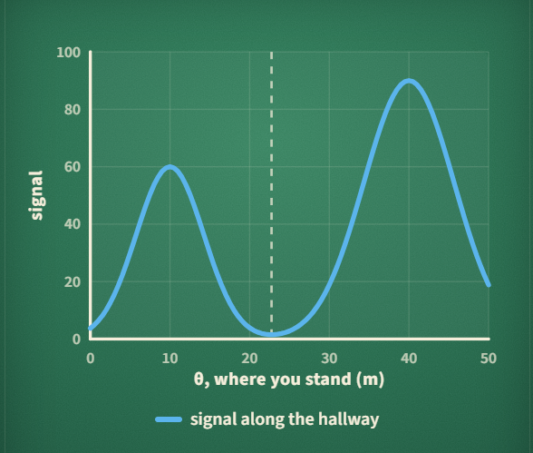

## Two routers

You walk down a 50 m hallway with a laptop, looking for the strongest Wi-Fi. Your parameter is θ, where you stand, in meters from one end, and the score is the signal strength. A weak router sits at 10 m and a strong one at 40 m. Between them, the signal is weakest at about 23 m, marked by the dashed line. The picture shows the signal along the whole hallway, which you can’t see while you walk: you only test where you stand.

You climb: nudge a step each way, move toward the stronger signal, and stop when every nudge makes it weaker. From which starting spots do you end up at the strong router? Pick the choice that names all of them.

A. Anywhere past about 23 m, beyond the dip \
B. Anywhere past 10 m, beyond the weak router \
C. Only between 30 m and 50 m, near the strong router \
D. Anywhere at all: a climb always finds the strongest signal

#### **Answer:** Option A: Anywhere past about 23 m, beyond the dip

---

**Explanation**

**The idea**
Where you start decides which top you climb: each top collects the starts on its side of the dip.

**Solution**
Anywhere past about 23 m. The signal is lowest at 22.75 m, the bottom of the dip between the routers. Start to the right of it and every uphill step leads toward 40 m. Start to the left and every uphill step leads toward 10 m, where the climb stops on the weak router’s top.

Passing the weak router is not enough: from 12 m, uphill still points back toward 10 m. And you need not start near the strong router: from 25 m, uphill already points toward 40 m. Each top collects the starts on its side of the dip. That is why starting climbs from several places, and keeping the best top, often finds the strongest signal.