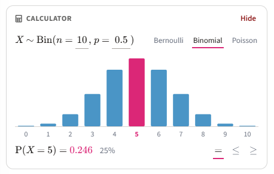
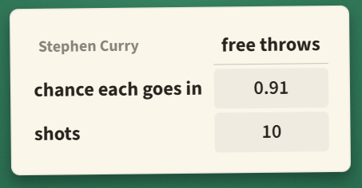

## Ten free throws

Stephen Curry makes about 91% of his free throws, the best career rate in NBA history. Suppose each shot goes in with chance 0.91, independently of the others, and he takes 10.

Which is more likely: he makes all 10, or he makes exactly 9?

A. All 10
B. Exactly 9
C. They are equally likely

#### **Answer:** Option A: All 10

---

**Explanation**

**The idea**
A binomial chance weighs how likely each sequence is against how many sequences there are.

**Solution**
All $10:{0.9}^{10} ≈0.389$.

Exactly 9: pick which shot misses (10 ways), and each way has chance $0.9^9 × 0.09$, so $10 ×  0.9^9 ×  0.09 ≈0.385$

All 10 wins, barely. A miss is about 10 times less likely than a make, and the one miss has 10 shots to hide in, which almost evens it out. That count of ways is the binomial: 
$P(X=k)=$ $\binom{10}{k} 0.91^k 0.0.9^{10-k}$. (Curry's rate: NBA.com, 2024.)