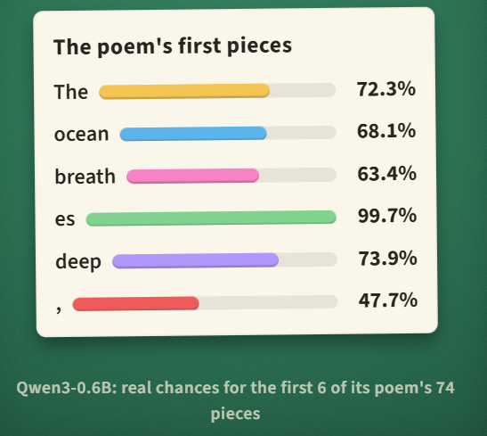

## The poem or nothing

A chatbot writes its reply one piece at a time, where a piece is a word or part of a word. Each piece has a chance, like the bars in the picture. The chance of the whole reply is all of those chances multiplied together.

We asked a small chatbot for a short poem about the ocean. Its 74-piece poem had a chance of about $8.5 × 10^{−30}$. Replying with nothing at all had a chance of about $8.7 × 10^{−13}$.

The empty reply is about $10^N$ times more likely than the poem. What is N?

#### **Answer:** 17

---

**Explanation**

**The idea**
The chance of a whole reply is the product of the chances of its pieces.

**Solution**

$\frac{8.7 × 10^{−13}}{8.5 × 10^{−30}} ≈ 1 × 10^{17}$, so N = 17.

Every piece of a reply multiplies in a number below 1, so a long reply ends up with a tiny chance. The single most likely reply is often nothing at all, which is one reason chatbots pick each piece at random instead of hunting for it.