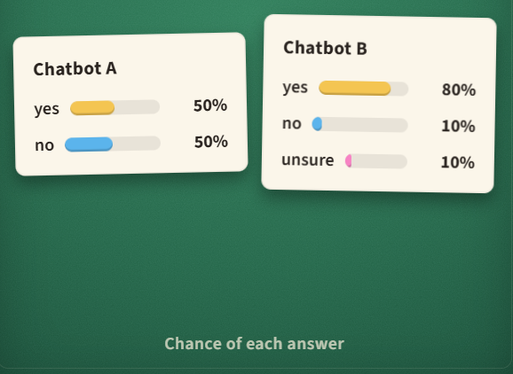

## Which model repeats itself?

Two chatbots answer the same question. Each chart shows one chatbot's chance of giving each answer, and its bars add up to 1.

You ask each chatbot the question twice. Each time, it picks its answer at random from its chart, independently of the other time. Which chatbot is more likely to give the **same answer both times?**

A. Chatbot A \
B. Chatbot B \
C. They are equally likely

#### **Answer:** Option B: Chatbot B
---

**Explanation**

**The idea**
A chatbot that is confident in one answer repeats itself.

**Solution**
Chatbot B. Two answers match when both are the same, and the two answers are independent, so multiply each chance by itself and add.

Chatbot A: $0.5^2 + 0.5^2 = 0.5$ \
Chatbot B: $0.8^2 + 0.1^2 + 0.1^2 = 0.66$

A chatbot that puts most of its chance on one answer repeats itself more, even though it has more answers to choose from.