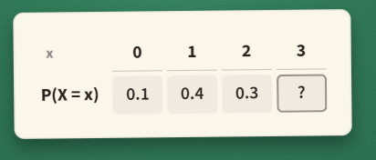

## The missing entry

A random variable X takes the values 0, 1, 2, and 3. Three of its probabilities are shown. What is $P(X=3)$? Give your answer to three decimal places.

#### **Answer:** 0.2
---

**Explanation**

**The idea**
A distribution's probabilities always add up to 1.

**Solution**
The probabilities of all the values must add to 1, so $P(X=3) 1 − 0.1 − 0.4 − 0.3 = 0.2$.