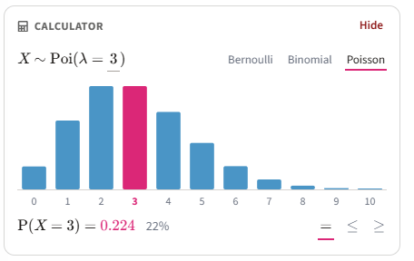
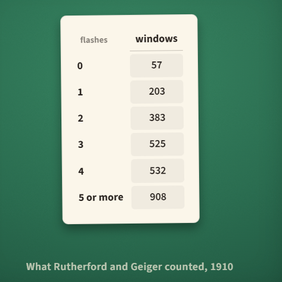

## Rutherford's flashes

In 1910, Ernest Rutherford and Hans Geiger watched a speck of radioactive metal in the dark. Each time an atom broke apart, they saw a tiny flash. They counted the flashes in 2,608 windows of 7.5 seconds each and saw **3.87** flashes per window on average. The table shows what they counted.

Suppose the number of flashes in a window is Poisson with an average of 3.87. What chance does that story give a window with **no** flashes at all? Give your answer to three decimal places.

#### **Answer:** 0.0209
---

**Explanation**

**The idea**
A Poisson story with one knob can match real counts.

**Solution**
The Poisson PMF at 0 is $P(X=0)=e^{−3.87}≈0.021$.

That predicts $2,608 × 0.021 ≈ 54$ empty windows, and Rutherford and Geiger counted 57, a fraction of $\frac{57}{2,608} ≈ 0.022$. A story with a single knob matches what they saw in the dark.