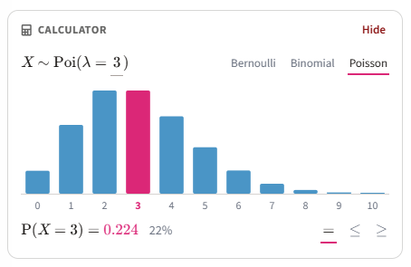

## Poisson by the Book

Suppose a book has an average of 2 typos per page, and the number of typos on a page follows a Poisson distribution. What is the chance that a randomly chosen page has at least one typo? Give your answer to three decimal places.

#### **Answer:** 0.864665
---

**Explanation**

**The idea**
"At least one" is one minus "none".

**Solution**
"At least one typo" covers 1, 2, 3 or more typos. Instead of adding all those chances, use the complement:
$$
P(X≥1) = 1 − P(X=0)
$$

With an average of 2 per page, $P(X=0) = e^{-2}≈ 0.135$, so the chance of at least one typo is $ 1 - 0.135 ≈ 0.865$.