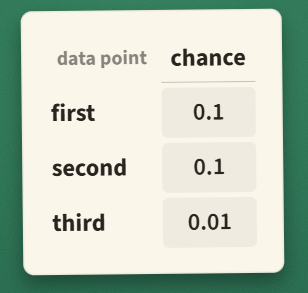

## Products into sums
Three data points had chances 0.1, 0.1, and 0.01, so the likelihood is 0.1 × 0.1 × 0.01. What is its score, the log₁₀ of the likelihood?

#### **Answer:** -4
---

**Explanation**

**The idea**
A score adds one log term per data point.

**Solution**
The log of a product is the sum of the logs:

$$
−1−1−2=−4.
$$

So a score adds one term per data point, and one chance of 0.01 costs as much as two chances of 0.1.