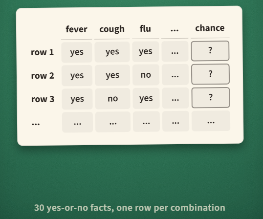

## One table for thirty

A medical app keeps track of **30** yes-or-no facts about a patient, such as fever, cough, or flu. One way to store what it knows is a table with one row for every possible combination of yes and no answers, and the chance of that combination.

About how many rows would that table need?

A. About 900 \
B. About 30 thousand \
C. About 1 million \
D. About 1 billion

#### **Answer:** Option D: About 1 billion

---

**Explanation**

**The idea**
Tables of every combination explode; a story with a few knobs does not.

**Solution**
Each new yes-or-no fact doubles the number of combinations, so 30 facts need $2^{30} = 1,073,741,824$ rows: about a billion.

A probabilistic model avoids the table. It tells a story of what causes what, with a few knobs. The bat story from the lessons describes 6 yes-or-no facts with just 10 knobs, where a table would need $2^6 = 64$ rows.
