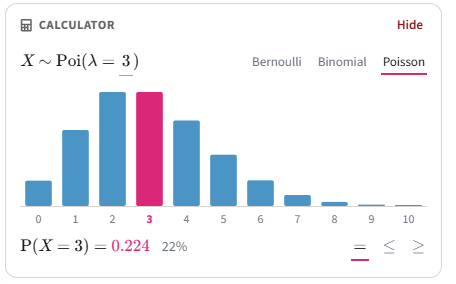
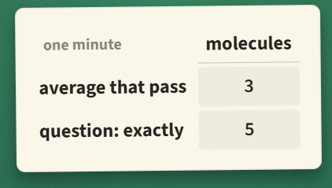

## Drug Hunter

A computational chemist uses an AI model to screen molecules for possible new drugs. On average, **3** molecules per minute pass the lab's filters for a likely drug.

Assume the number of molecules that pass in one minute follows a Poisson distribution. What is the chance that exactly **5** pass in a randomly chosen minute?

A. Approximately 10.08% \
B. Approximately 16.80% \
C. Approximately 4.98% \
D. Approximately 95.02%

#### **Answer:** Option A: Approximately 10.08%

---

**Explanation**

**The idea**
A count of events at a steady average rate is a Poisson, and its λ is that average.

**Solution**
The count is a Poisson with $λ=3$, the average per minute, and the question is $P(X=5)$:

$$
P(X=5)= \frac{3^5 e^{-3}}{5!} ≈0.1008,
$$
​
about 10%. Five is above the average of 3, so it happens only about one minute in ten.