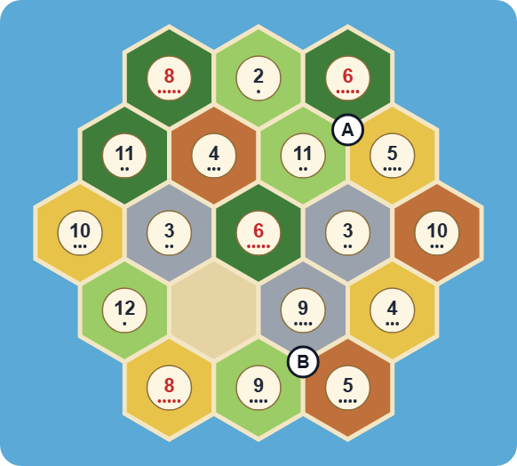

## Probability on the Isle of Catan

In the board game *Settlers of Catan*, players place settlements at the vertices (corners) of hexagonal tiles. Each tile has a number from 2 to 12, and each turn, two fair six-sided dice are rolled and their values are added together. Whenever the sum matches the number on a tile adjacent to your settlement, you receive a resource card from that tile.

Suppose you can build a settlement at either vertex **A** or vertex **B**, as shown in the diagram.

Which location gives you a higher probability of receiving a resource card on a given turn?

A. $P(A) > P(B)$  \
B. $P(B) > P(A)$ \
C. $P(A) = P(B)$

#### **Answer:** Option A: $P(A) > P(B)$

---

**Explanation**

**The idea**
Add dots only across different numbers: two tiles with the same number pay out on the same roll.

**Solution**
Let X and Y be the results of the two dice. Since each die has 6 possible outcomes, there are 36 equally likely outcomes when we roll both dice.

The events $X+Y=5$ and $X+Y=6$ are mutually exclusive because the dice cannot have two different sums on the same roll. Therefore, we can add the probabilities of rolling different sums to find the probability of rolling any of a collection of sums.

For example, $P(X+Y=5)= \frac{4}{36}$ since there are four outcomes that give a sum of 
5:

$$
(1,4),(2,3),(3,2),(4,1)
$$

Similarly, $P(X+Y=6)= \frac{5}{36}$ since there are five outcomes that give a sum of 
6: $ (1,5), (2,4), (3,3), (4,2), (5,1) $

Notice that the number of dots beneath each tile number is proportional to the probability of rolling that number. Each dot represents one of the 36 equally likely outcomes.

**At vertex A:** The adjacent tiles have numbers $(6,11,5)$. These numbers have 
$(5,2,4)$ dots respectively, for a total of 
11 dots. Therefore,

$$
P(receive a card at A) = \frac{11}{36}
$$
​
**At vertex B:** The adjacent tiles have numbers $(9,9,5)$. The two 9 tiles pay out on the same roll, so they are not separate events: you receive a card at B exactly when the sum is 9 or 5. These two sums have 
4 dots each, for a total of 8 dots. Therefore,

$$
P(receive a card at B) = \frac{8}{36}
$$

Rolling a 9 at B does give you two cards at once, but it is still a single roll, so it counts once here.

Therefore, vertex A gives the higher probability of receiving a resource card on a given turn.

*Catan is a board game by Klaus Teuber (1995)*.