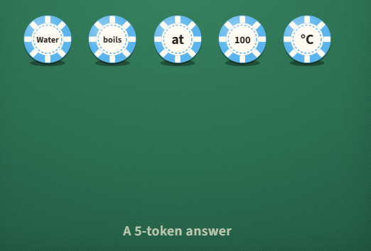

## How perfect is the LLM?

A large language model writes its answer one token at a time. Each token is either grounded, meaning factual, or hallucinated, meaning made up.

Suppose that in a 5-token answer, the chance that at least one token is hallucinated is 0.41. Assume each token is grounded with the same chance, independently of the others. What is the chance that a single token is grounded? Give your answer to three decimal places.

#### **Answer:** 0.9

---

**Explanation**

**The idea**
"At least one" is one minus "none", and independence turns "none" into a power.

**Solution**
Let *p* be the chance that a single token is grounded. The opposite of "at least one token is hallucinated" is "all 5 tokens are grounded", so

$$
P(\text{all 5 grounded}) = 1 - 0.41 = 0.59
$$

The tokens are independent, so 
$P(\text{all 5 grounded}) = p^5$. \
Then

$$
p^5 = 0.59,\quad p = \sqrt[5]{0.59} \approx 0.900
$$

Stopping at 0.59 is a common slip: that is the chance that all five tokens are grounded, not the chance for one token.

