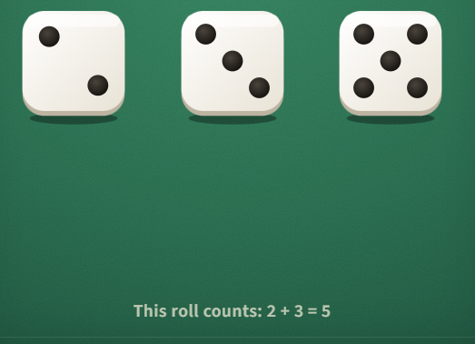

## Sum of the other two

You roll three fair six-sided dice. What is the chance that one die shows the sum of the other two? For example, a roll of 2, 3, and 5 counts, because 2 + 3 = 5. Give your answer to three decimal places.

#### **Answer:** 0.208333

---

**Explanation**

**The idea**
Count ordered outcomes, and check that no outcome is counted twice.

**Solution**
Count rolls in order: $6×6×6=216$ equally likely outcomes. If the third die is the sum, the first two must add up to at most 6. There is 1 way to make 2, 2 ways to make 3, and 3, 4, and 5 ways to make 4, 5, and 6: 15 ways in all.

Any of the 3 dice can be the sum, and no roll counts twice, since two different dice cannot each be the sum of the other two. So there are
$3×15=45$ good rolls, and the chance is $\frac{45}{216} = \frac{5}{24} ≈0.208$.
