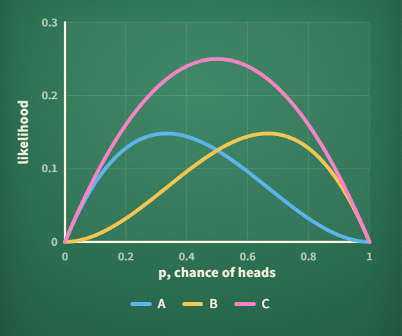

## Pick the likelihood

You flip a coin 3 times and get **H, H, T**. One of these curves is the likelihood of 
*p*, the chance of exactly these flips. Which one?

A. A \
B. B \
C. C

#### **Answer:** Option B: B

---

**Explanation**

**The idea**
A likelihood curve peaks at the maximum likelihood estimate.

**Solution**
B, which is $p^2(1−p)$. It peaks at $p = \frac{2}{3}$, the fraction of heads seen. A peaks at $\frac{1}{3}$ (1 head in 3) and C at $\frac{1}{2}$ (1 head in 2).