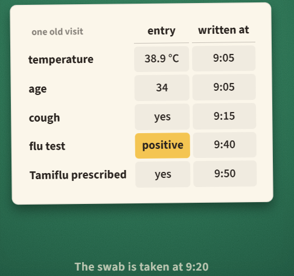

## A feature that knows

Suppose a clinic wants a model that predicts whether a patient’s flu test will come back positive. It runs the moment the nurse takes the swab, so a doctor can start treatment while the test runs. The team trains it on old visits. The board shows one visit, with the time each entry was written down. Tamiflu is a flu medicine.

Which feature would make the model look great on its test set, then fail in the clinic?

A. The temperature

B. The age

C. The cough

D. Tamiflu prescribed

#### **Answer:** Tamiflu prescribed
---

**Explanation**

**The idea**
For every feature, ask: will the model have it at the moment it runs?

**Solution**

Tamiflu prescribed. It is written at 9:50, after the test result at 9:40: the doctor prescribes it because the test came back positive. In the old records it almost always matches the result, so a model trained on them leans on it and scores wonderfully on its test set, which comes from the same old records. In the clinic the model runs at 9:20, when no prescription exists yet.

The cough is written after check-in, but before the swab, so the model can use it. A feature that carries the answer like Tamiflu does is called a leak.