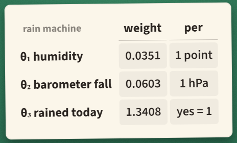

## Reading the weights

The rain machine from the Logistic Regression lesson gives rain tomorrow the chance 
$σ(θ_0+θ_1x_1+θ_2x_2+θ_3x_3)$. Its features are $x_1$, the humidity minus 70%; 
$x_2$, how many hPa the barometer fell; and 
$x_3$, which is 1 if it rained today. The table shows its trained weights.

Start from a dry day and change one thing, keeping the others fixed. Which one change raises tomorrow’s chance of rain the most?

A. 30 more points of humidity

B. The barometer falls 20 hPa more

C. It rains today

D. All three raise it the same

#### **Answer:** It rains today
---

**Explanation**

**The idea**
Compare weight × change, not the weights alone.

**Solution**

It rains today. Each change moves the weighted sum by weight × change:

$$humidity: 0.0351×30=1.053$$
$$barometer: 0.0603×20=1.206$$
$$rain today: 1.3408×1=1.3408$$

$σ$ only goes up as its input goes up, so the biggest move in the weighted sum gives the biggest chance.

Comparing the weights alone would mislead: $θ₁$ is the smallest weight, yet $30$ points of humidity moves the sum $1.053$, close to the other two. What counts is weight times change.

