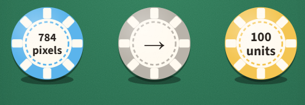

## Count the parameters

A 28 × 28 image has 784 pixels. A layer connects every pixel to each of 100 hidden units, and each hidden unit also has a bias.

How many numbers does training have to learn in this layer?

#### **Answer:** 78500 parameters
---

**Explanation**

**The idea**
A fully connected layer has (inputs + 1) × units parameters.

**Solution**

Each of the 100 units has 784 weights and 1 bias:

$$100×(784+1)=78,500.$$

All of them are tuned by the same gradient ascent you used for a single coin's 
$p$.