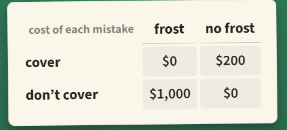

## Cover the strawberries?

Suppose a farmer decides each cold night whether to cover a strawberry field. Count only the mistakes: covering on a night with no frost wastes $200, and leaving the field uncovered on a frost night loses $1,000.

A forecast model says the chance of frost tonight is $p$. Above what chance should the farmer cover the field? Give your answer to three decimal places.

#### **Answer:** 0.166667
---

**Explanation**

**The idea**
Turn a chance into a decision by weighing what each mistake costs.

**Solution**

Skip the cover and you lose $1,000 when frost comes: \
$1,000×p$. Cover and you waste $200 when no frost comes: \ 
$200×(1−p)$. Cover when

$$
1000p>200(1-p)
$$,

that is, when

$$
p > \frac{200}{1,200} = \frac{1}{6} ≈ 0.167.
$$

A chance of 1 in 6 is enough, because a frost costs five times as much as a wasted cover. With a chance, each farmer can set the cutoff their own costs call for. A plain yes-or-no forecast can’t do that.