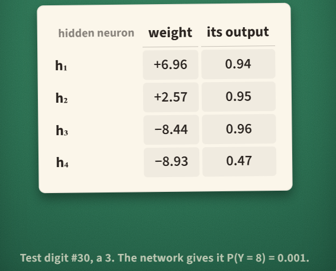

## The biggest veto

The Deep Learning lesson’s network has four hidden neurons. Its output neuron adds up weight × output for each of them, adds its bias, and applies $σ$ to get $P(Y=8)$. A hidden neuron’s output runs from 0, when it stays quiet, to 1, when it fires.

For this test digit, a 3, which hidden neuron does the most to keep the network from calling it an 8?

A. $h₁$

B. $h₂$

C. $h₃$

D. $h₄$

#### **Answer:** $h₃$
---

**Explanation**

**The idea**
A hidden neuron’s push is its weight × its output, not its weight alone.

**Solution**

$h₃$. Each hidden neuron adds weight × output to the output neuron’s weighted sum:

$$h_1:6.96×0.94≈+6.54$$
$$h_2:2.57×0.95≈+2.44$$
$$h_3:−8.44×0.96≈−8.10$$
$$h_4:−8.93×0.47≈−4.20$$

$h₄$ has the more negative weight, but it only half fires on this 3. $h₃$ fires almost fully, so its veto takes away the most. With the bias, $−3.32$, the weighted sum is about 
$−6.64$, and $σ(−6.64)≈0.001$.

Nobody told $h₃$ and $h₄$ to veto. Training found it.

