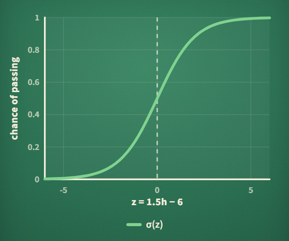

## On the fence

A model gives a student the chance $σ(1.5h−6)$ of passing, where $h$ is hours studied.

At how many hours does the model say exactly 50%?

#### **Answer:**  4 hours
---

**Explanation**

**The idea**
The model says 50% where its weighted sum is 0.

**Solution**

The model says 0.5 exactly when the weighted sum is 0, so solve $1.5h−6=0: h=4$ hours.

Below 4 hours the model leans "fail", above it "pass", and the further from 4 hours, the more sure it gets.