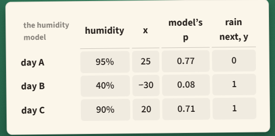

## Surprise times evidence

Gradient ascent takes steps new $θ = θ + step size × \frac{∂score}{∂θ}$, where the score is the log likelihood. For the humidity weight $θ$ of a model that uses only humidity,

$$
\frac{\partial \text{score}}{\partial \theta} = \sum_{\text{days}} (y - p) x \div \ln 10,
$$

where $y$ is 1 if it rained the next day and 0 if not, $p$ is the chance of rain the model gave, and $x$ is the humidity minus 70%.

Add up the three days’ terms $(y−p)x$, before dividing by $ln10$. What is that total? Give your answer to three decimal places.

#### **Answer:**  $-41.05$
---

**Explanation**

**The idea**
Each day pulls a parameter by its surprise times its evidence.

**Solution**

Each term is surprise times evidence:

$$A: (0−0.77)×25=−19.25$$
$$B: (1−0.08)×(−30)=−27.6$$
$$C: (1−0.71)×20=5.8$$

The total is −41.05, so for these days $\frac{∂score}{∂θ} =−41.05÷ln10≈−17.8$. It is negative, so the step lowers the humidity weight.

Day A was humid and stayed dry. Day B was dry and it rained. Both surprised the model, and both say humidity matters less than it thinks. Day C went as expected, so it pulls the other way, but only a little.

