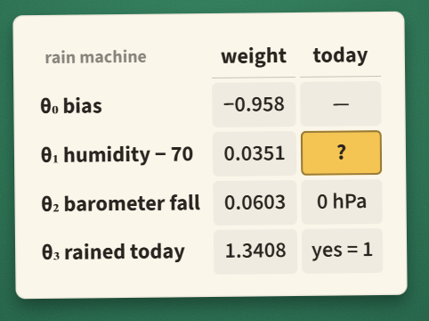
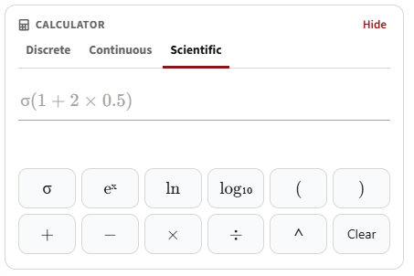

## Where the line falls

The rain machine from the Logistic Regression lesson gives rain tomorrow the chance $σ(θ_0+θ_1x_1+θ_2x_2+θ_3x_3)$. Its features are 
$x_1$, the humidity minus $70%$;  $x_2$, how many hPa the barometer fell; and 
$x_3$, which is 1 if it rained today. The table shows its trained parameters.

Today it rained, and the barometer held steady. At what humidity does the model say exactly 50 in 100? Give your answer as a humidity in percent, to one decimal place.

#### **Answer:**  $59.094$
---

**Explanation**

**The idea**
The model says 50 in 100 where its weighted sum is 0.

**Solution**

50 in 100 means the weighted sum is 0. With $x_2 =0$ and $x_3=1$:

$$−0.958 + 0.0351x_1 + 1.3408 = 0
$$,

so

$$x_1 = -\frac{0.3828}{0.0351} ≈−10.9.$$
 
That is 10.9 points below 70%: about 59.1% humid. On rainy, steady days, wetter ones get more than 50 in 100 and drier ones less.

After a dry day the 50-in-100 humidity is 
$70+0.958÷0.0351≈97.3%$. Rain today moves it by $1.3408÷0.0351≈38$ points: to this model, rain today counts as much as 38 more points of humidity.

