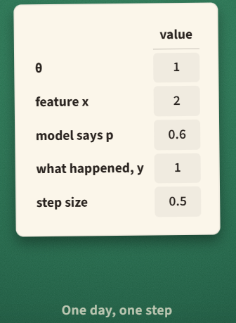

## One step of learning

Gradient ascent takes steps new $θ = θ + step size × \frac{∂score}{∂θ}$, where the score is the log likelihood. For one training day,

$$
\frac{\partial \text{score}}{\partial \theta} = \sum_{\text{days}} (y - p) x \div \ln 10,
$$

What is the new $θ$ after one step? Give your answer to three decimal places.

#### **Answer:**  $1.17372$
---

**Explanation**

**The idea**
Each day nudges a parameter by its surprise times its evidence.

**Solution**

The surprise is $y−p=1−0.6=0.4$, so $\frac{∂score}{∂θ}=0.4×2÷ln10≈0.347$, and

$$new θ=1+0.5×0.347≈1.174
$$.

$θ$ grows, which raises $p$ for this day next time. A day the model already predicts confidently and correctly has $y−p$ near $0$ and barely moves it.

