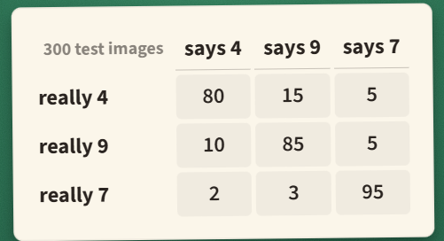

## When it says nine

A network that tells 4s, 7s, and 9s apart was tested on 300 images, 100 of each digit. The table counts what it said for each true digit.

When the network says 9, what is the chance the digit really is a 9? Give your answer to three decimal places.

#### **Answer:**  $0.825$
---

**Explanation**

**The idea**
Read a confusion table down a column to condition on the prediction.

**Solution**

The network said 9 for 
$15+85+3=103 images$, and 85 of them really were 9s:

$$
P(\text{really 9} \mid \text{says 9})
= \frac{85}{103}
\approx 0.825
$$

That differs from $P(says 9∣really 9)=0.85$: conditioning on what the network says is a different question from conditioning on the truth.

