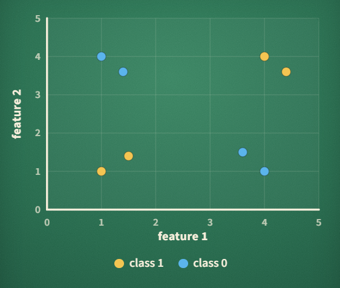

## The best a line can do

Logistic regression on two features splits the plane with a straight line: one class on each side.

For these 8 points, what is the most that **any** straight line can classify correctly?

#### **Answer:** 6 points
---

**Explanation**

The idea
On its raw features, logistic regression can only draw a straight boundary.

Solution
Six. A line can cut off one corner pair and call the other three pairs the other class, getting one pair wrong. No line gets 7: then every corner keeps a correct point, so the gold side holds a point from both gold corners and the whole segment between them, and the blue side holds a segment joining the blue corners. Those two segments cross, and no point can be on both sides.

This pattern is called $XOR$. To fit it, a model needs a curved boundary, or a new feature such as $x_1 × x_2$. That is one of the things neural networks are for.

