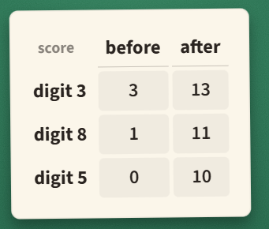

## Add ten to every score

A network that tells 3s, 5s, and 8s apart scores one image: 3 scores 3, 8 scores 1, and 5 scores 0. Now add 10 to every score, so 3 scores 13, 8 scores 11, and 5 scores 10.

What happens to the probability softmax gives to 3?

A. It goes up

B. It goes down

C. It stays the same

D. It becomes 1

#### **Answer:** It stays the same
---

**Explanation**

The idea
Softmax only cares about the gaps between scores.

Solution
It stays the same. Adding 10 multiplies every 
$e^s$ by $e^{10}$, on the top and the bottom of softmax alike, so it cancels:

Use this Markdown in VS Code:

markdown

$$
\frac{e^{13}}{e^{13}+e^{11}+e^{10}}
= \frac{e^{10}e^3}{e^{10}(e^3+e^1+e^0)} 
\approx 0.844
$$

Only the gaps between scores matter. Real code uses this: it subtracts the largest score before exponentiating, so $e^s$ never overflows.