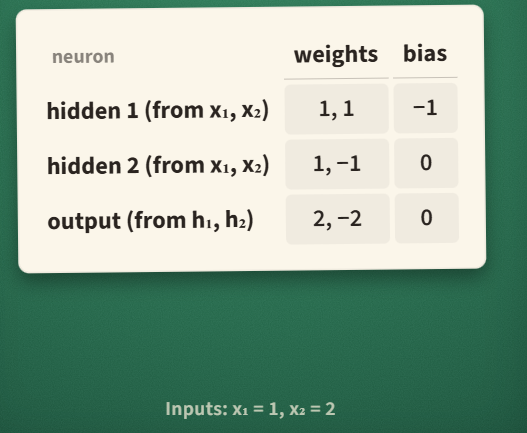

## Run a tiny network

A tiny network has inputs $x_1=1$ and $x_2=2$. Each hidden neuron is a logistic regression: it multiplies $x_1$ and $x_2$ by its two weights from the table, in that order, adds its bias, and applies $σ$. The output neuron does the same with $h_1$ and $h_2$.

What probability does the network output? Give your answer to three decimal places. The calculator below has a $σ$ key.

#### **Answer:** 0.773
---

**Explanation**

**The idea**
A network is logistic regressions, stacked: each neuron’s output is a feature for the next.

**Solution**

Hidden neuron 1: $h_1=σ(1+2−1)=σ(2)≈0.881$. Hidden neuron 2: $h_2 =σ(1−2+0)=σ(−1)≈0.269$. The output neuron reads them as its features. Its weighted sum is

$$2×0.881−2×0.269+0≈1.224
$$,

so it outputs

$$σ(1.224)≈0.773
$$.

Without $σ$ on the hidden neurons, the whole network would collapse to one weighted sum of $x_1$ and $x_2$: plain logistic regression, with a straight boundary. The bend in each hidden $σ$ is what lets a network draw boundaries that are not straight.

