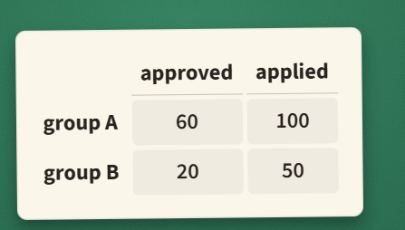

## The approval gap

A model approves 60 of 100 applicants from group A and 20 of 50 applicants from group B. By how much do the two approval rates differ? Give your answer to three decimal places.

#### **Answer:** 0.200
---

**Explanation**

**The idea**
Compare groups by rates, since group sizes differ.

**Solution**

Group A is approved at $\frac{60}{100} = 60$% 
and group B at $\frac{20}{50} = 40$% : a gap of 20 percentage points, or 0.2. Asking for equal approval rates is one definition of fairness, called parity fairness in the Alignment lesson. It is one of several, and they can conflict.

