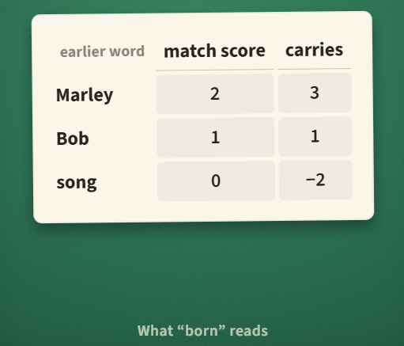

## What attention passes on

In the Inside a Large Language Model lesson, a word reads the words before it. It gives each earlier word a match score, and softmax squashes the scores into attention shares. Then it takes in what each earlier word carries, times that word’s share, all added up.

Suppose the word “born” reads just three earlier words, and each one carries a single number.

What number does attention pass on to “born”? Give your answer to three decimal places. The calculator below has an $eˣ$ key.

#### **Answer:** 2.060
---

**Explanation**

**The idea**
Attention passes on an average of what earlier words carry, weighted by their shares.

**Solution**

Softmax turns the match scores into shares. The total is $e^2 +e^1 +e ^0 ≈11.107$, so

$$Marley: 7.389÷11.107≈0.665$$

$$Bob: 2.718÷11.107≈0.245$$

$$song: 1.000÷11.107≈0.090$$

Then “born” takes in each number times its share:

$$0.665×3+0.245×1$$
$$+0.090×(−2)≈2.060.$$

The shares are positive and add up to 1, so they work like the probabilities of a PMF, and this sum is Lesson 5’s expectation: each value times its probability, added up. Marley gets two thirds of the weight, so the result sits closest to what Marley carries.

