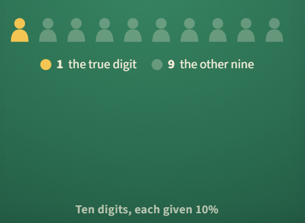
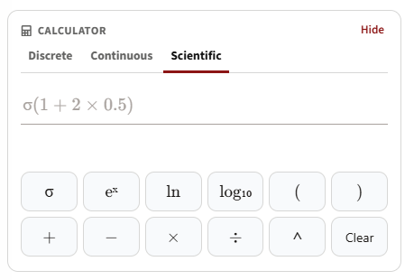

## A network that knows nothing

Suppose that before training, a digit recognizer gives each of the 10 digits the same probability, whatever the picture.

What is its log likelihood $(log_{10})$, added up over the 10,000 test digits of the classic MNIST dataset? Give your answer as a whole number.

#### **Answer:** -10000
---

**Explanation**

**The idea**
Guessing evenly over $k$ labels scores 
$log_{10} \frac{1}{k}$ per example.

**Solution**

Whatever the true digit is, the network gives it $P(label)= \frac{1}{10}$, so each test digit adds $log_{10} 0.1=−1$. Over 10,000 digits:

$$10,000×−1=−10,000
$$.

Training pushes each digit’s $log_{10}$ toward $log_{10} 1=0$. A trained network that gives a digit’s label $0.99$ scores it about $−0.004$.

