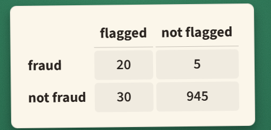

## Caught in the net

A fraud detector is checked on a test set of 1,000 transactions that includes 25 known frauds. It flags 50 transactions, and 20 of the flagged ones are fraud.

What fraction of all the fraud does it catch? Give your answer to three decimal places.

#### **Answer:**  0.8
---

**Explanation**

**The idea**
Recall: fraction of real cases caught. Precision: fraction of flags that are real.

**Solution**

It catches $\frac{20}{25} = 0.8$ of the fraud. That is its recall. Its precision, the fraction of flags that are fraud, is only $\frac{20}{50} = 0.4$. Which one matters more depends on what a miss costs, and what a false alarm costs.