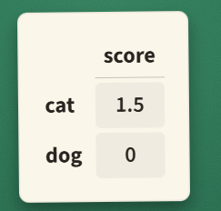

## Softmax for two

A cat-or-dog network scores "cat" 1.5 and "dog" 0. What probability does softmax give to "cat"? Give your answer to three decimal places.

#### **Answer:**  0.818
---

**Explanation**

**The idea**
With two classes, softmax is the sigmoid.

**Solution**

$$\frac{e^{1.5}}{e^{1.5} e^0} ≈ \frac{4.48}{5.48} ≈ 0.818.$$

That is exactly $σ(1.5)$: with two classes, softmax is the sigmoid of the gap between the scores. Logistic regression is the two-class case.

