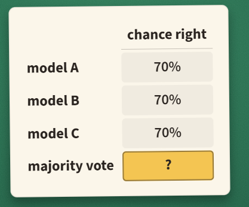

## Wisdom of three

Three models each label a photo "cat" or "dog", and each is right 70% of the time. Their mistakes are independent. They take a majority vote.

What is the chance the vote is correct? Give your answer to three decimal places.

#### **Answer:** 0.784
---

**Explanation**

**The idea**
Independent mistakes cancel out in a vote.

**Solution**

All three are right with chance $0.7^3 =0.343$. Exactly two are right with chance 
$3×0.7^2×0.3=0.441$. Together:

$$0.343+0.441=0.784 
$$.

The vote beats every single model because their mistakes are independent: three copies of one model would make the same mistakes and gain nothing.

