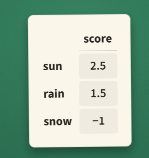

## Mind the gap

A network scores three words: "sun" 2.5, "rain" 1.5, and "snow" −1. After softmax, how many times as likely as "rain" is "sun"? Give your answer to three decimal places.

#### **Answer:**  2.718 times
---

**Explanation**

**The idea**
In softmax, a score gap of d means $e^d$ times as likely.

**Solution**

The softmax denominator cancels, leaving

$$\frac{e^{2.5}}{e^{1.5}} = e^1 ≈2.718
$$.

The ratio depends only on the gap between the two scores, not on any other word. Raising "snow" would change both probabilities but not their ratio.

