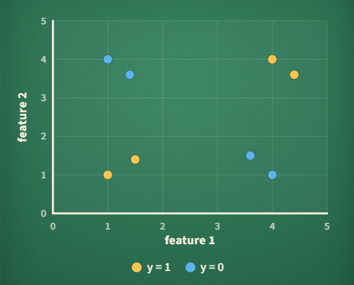

## One extra feature

Here is a new idea. Logistic regression with two features says yes(y=1) when its chance 
$σ(θ_0 +θ_1 f_1 + θ_2 f_2)$ is above 0.5, which happens exactly when the weighted sum inside is above 0. The points where that sum is exactly 0 form a straight line on this plot, called the decision boundary: yes on one side, no (y=0) on the other.

No straight line can put all the gold points (y=1) on one side and all the blue points (y=0) on the other. Now give logistic regression one extra feature, computed from feature 1 $(f_1)$ and feature 2 $(f_2)$. In the choices, $∣a∣$ means a with any minus sign dropped, so ∣−2∣=2.

Which extra feature lets it say yes for every gold point and no for every blue one?

A. f₁ + f₂

B. |f₁ − f₂|

C. 2 × f₁

D. f₁ − f₂

#### **Answer:**  Option B. |f₁ − f₂|
---

**Explanation**

**The idea**
Hidden neurons learn new features, so a straight cut can split hard problems.

**Solution**

$∣f_1 − f_2∣$. Gold points sit near the diagonal, so $∣f_1 − f_2∣$ is at most 0.8 for them; blue points sit far from it, at 2.1 or more. With it, logistic regression can say yes when $∣f_1 − f_2∣$ is below 1.5 and no when it is above, which splits them perfectly.

The other three choices are straight-line combinations of $f_1$ and $f_2$, so adding them still leaves a straight decision boundary. Hidden neurons can learn a feature that does this job, with no one telling them what to look for: that is how they invent their own evidence.

