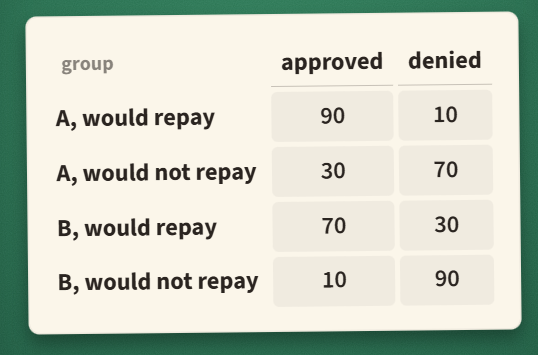

## Same accuracy, different mistakes

A loan model is 80% accurate for applicants in group A and 80% accurate in group B. The table counts its decisions for 200 applicants from each group.

Among applicants who would repay, how many times as likely is someone in group B to be denied as someone in group A?

#### **Answer:**  3 times
---

**Explanation**

**The idea**
A model can be fair by accuracy and unfair by equality of odds.

**Solution**

Of group A's 100 repayers, 10 are denied: 10%. Of group B's 100, 30 are: 30%. That is 3 times as likely.

Both groups see 80% accuracy, yet the model's mistakes land differently: group A gets risky loans approved, and group B gets good applicants turned away. In the Alignment lesson’s words, the model is fair by accuracy but not by equality of odds: among people who would repay, it says yes to 90% of group A and only 70% of group B.