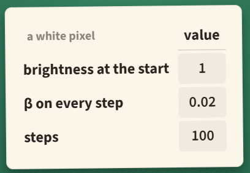

## How much of the 8 is left?

In the Beyond PAI lesson, diffusion walks an 8 into noise one small step at a time. Each step does

$$x \leftarrow \sqrt{1 - \beta} \, x + \sqrt{\beta} \, \text{noise},$$

where $x$ is a pixel’s brightness and the noise averages 0.

Suppose every step uses $β=0.02$. A white pixel starts at brightness 1.

On average, what is its brightness after 100 steps? Give your answer to three decimal places. The calculator below has a^ key.

#### **Answer:**  0.364
---

**Explanation**

**The idea**
Each noise step shrinks what is left of the picture by the same factor.

**Solution**

The average of a sum is the sum of the averages, and the noise averages 0, so each step multiplies the average brightness by $\sqrt{0.98}$. After 100 steps,

$$(\sqrt{0.98})^{100} = 0.98^{50} ≈0.364. $$
 
About a third of the white is left. Every step takes away the same share of what remains, while the noise keeps piling up, until the picture is almost pure noise. The network learns to walk those steps back.

