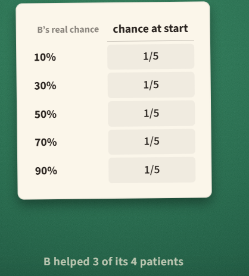

## Possible worlds

In the Beyond PAI lesson, treatment B helped 3 of its first 4 patients. To form a belief about B’s real chance of recovery, the lesson tried many possible worlds and kept the ones that fit.

Suppose there are just five possible worlds, where B’s real chance is 10%, 30%, 50%, 70% or 90%, each equally likely before any patient. Patients recover independently.

Given that 3 of 4 patients recovered, what is the chance that B’s real chance is 70%? Give your answer to three decimal places.

#### **Answer:**  0.399
---

**Explanation**

**The idea**
A belief about a chance can be a curve: every possible world, weighted by how well it fits.

**Solution**

How well each world fits 3 of 4:

$$10\%:\quad 4\times 0.1^3\times 0.9=0.0036 $$

$$30\%:\quad 4\times 0.3^3\times 0.7=0.0756 $$

$$50\%:\quad 4\times 0.5^3\times 0.5=0.2500 $$

$$70\%:\quad 4\times 0.7^3\times 0.3=0.4116 $$

$$90\%:\quad 4\times 0.9^3\times 0.1=0.2916 $$

The worlds start equally likely, so by Bayes’ theorem each one’s new chance is its fit divided by the total fit, 1.0324:

$$\frac{0.4116}{1.0324} ≈0.399.$$
​
 
70% is the most likely world, but 50% and 90% still keep 0.242 and 0.282: four patients don’t pin the chance down. With many more worlds, those shares become the curve the lesson drew, and Thompson sampling draws a world from it to pick the next treatment.
