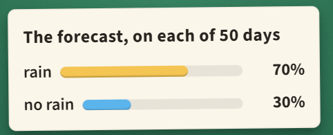

## Seventy-percent days

A calibrated weather forecaster said "70% chance of rain" on 50 different days. On how many of those days do you expect rain?

#### **Answer:**  35 days
---

**Explanation**

**The idea**
For a calibrated forecaster, the expected number of hits is the sum of the chances it gave.

**Solution**

Calibrated means 70% forecasts come true 70% of the time: 

$50×0.7=35$ rainy days. Far fewer or far more, and those 70% forecasts would not be calibrated.

