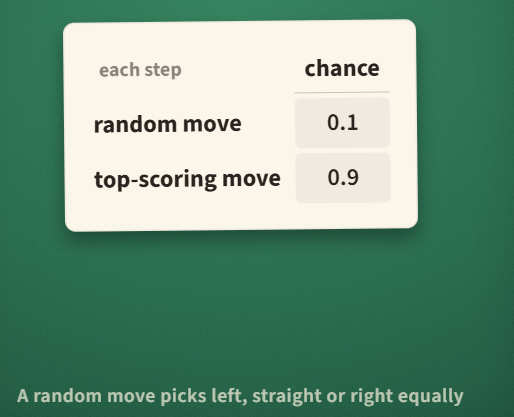

## Explore a little

In the Beyond PAI lesson, an agent learns from reward alone. At each step its network scores three moves, turn left, go straight and turn right, and the agent takes the top score. To explore, it sometimes moves at random instead.

Suppose that on each step it moves at random with chance 0.1, picking each of the three moves with equal chance. Otherwise it takes the top-scoring move.

What is the chance it takes the top-scoring move on a step? Give your answer to three decimal places.

#### **Answer:** 0.933
---

**Explanation**

**The idea**
A little random exploring rarely leaves the best-known move, yet it is how an agent learns what else might pay.

**Solution**

By the law of total probability,

$$0.9 × 1 + 0.1 × \frac{1}{3} ≈0.933.$$

So exploring costs less than it looks: it moves at random one step in ten, but only one step in fifteen goes somewhere other than the top move. Those few steps are how the agent finds out whether another move pays better.