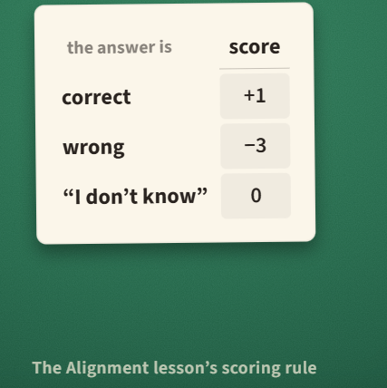

## When to say “I don’t know”

In the Alignment lesson, a model answers “Is this a real case?” from its $P(real)$. Above an upper bound it says “real”, below a lower bound it says “not real”, and in between it says “I don’t know”. The lesson’s scoring rule gives +1 for a correct answer, −3 for a wrong one, and 0 for “I don’t know”.

The model gives a case 
$P(real)=q$. Saying “real” earns +1 if the case is real and −3 if it is made up.

Above what value of $q$ does saying “real” earn more on average than saying “I don’t know”? Give your answer to three decimal places.

#### **Answer:** 0.75
---

**Explanation**

**The idea**
The scoring rule sets the bounds: the more a wrong answer costs, the more often “I don’t know” is the best answer.

**Solution**

On average, saying “real” earns

$$q×1+(1−q)×(−3)=4q−3.$$
That beats the 0 for “I don’t know” when 
$4q−3>0$, that is, when 
$q>0.75$. The same reasoning for “not real” gives $q<0.25$. So the best bounds are 0.25 and $0.75:$ answer only when the model is at least $75%$ sure, either way.

The lesson’s bounds of $0.40$ and $0.60$ answer when the model is only 60% sure, and each wrong answer costs as much as three right ones: that run scored $24−3×8=0$.

