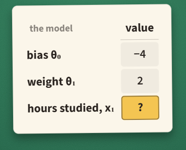

## Studying helps?

A logistic regression predicts whether a student passes an exam from the hours they studied, $x _1$:

$$P(Y=1)=σ(θ_0 +θ_1 x _1)
$$,

where $Y=1$ means the student passes. Its bias is $θ_0=−4$and its weight is $θ_1=2$.

How many hours of studying give the student a 50% chance of passing?

A. 2 \
B. 4 \
C. 6

#### **Answer:** Option A. 2 hours
---

**Explanation**

**The idea**
A logistic regression gives exactly 50% where its weighted sum is 0.

**Solution**

$2$ hours. $σ(z)=0.5$ exactly when $z=0$, so solve

$$−4+2x_1=0
$$,

which gives $x_1=2$. With less studying the weighted sum is negative and the chance is under $50%$; with more, it is over 50%. With no studying at all, the chance is $σ(−4)≈0.018$.

