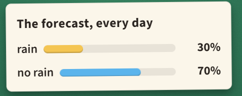

## Always thirty percent

It rains on 30% of days in a city. A forecaster says "30% chance of rain" every single day, whatever the sky looks like.

Is this forecaster calibrated?

A. Yes, perfectly calibrated

B. No, because it is never confident

C. No, because it rains on some of those days

#### **Answer:** Option A. Yes, perfectly calibrated
---

**Explanation**

**The idea**
Calibration is not enough: good forecasts also tell days apart.

**Solution**

Yes. Of all the days it said 30%, it rained on 30%, which is exactly what calibration asks.

But the forecasts never tell one day from another. A more useful forecaster is calibrated and sharp: it says 90% on days that look stormy and 5% on days that look clear, and it rains on about 90% and 5% of those days. Calibration alone is not enough.