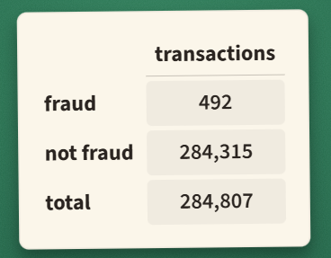

## The lazy fraud detector

A widely used fraud dataset holds 284,807 credit card transactions, and 492 of them are fraud. A lazy model says "not fraud" every time.

What is its accuracy? Give your answer to three decimal places.

#### **Answer:** 0.9983
---

**Explanation**

**The idea**
Accuracy can look great on rare events while missing all of them.

**Solution**

It is right on all 284,315 honest transactions:

$$\frac{284,315}{284,807}≈0.998.
$$
 
Over 99.8% accuracy, and it catches zero fraud. When one class is this rare, accuracy says little; ask how many of the rare cases the model catches.

