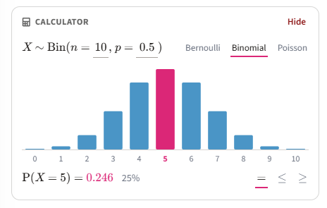
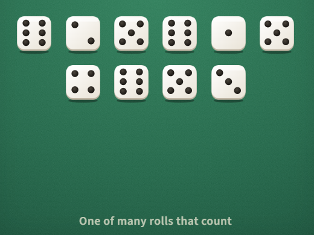

## Three sixes, three fives

You roll a fair six-sided die 10 times. What is the chance that exactly 3 rolls are sixes, exactly 3 are fives, and the other 4 show neither a six nor a five? Give your answer to three decimal places.

#### **Answer:** 0.0177818

---

**Explanation**

**The idea**
A question about two kinds of outcome can be split into two binomial steps.

**Solution**
Take it in two steps.

Sixes: each of the 10 rolls is a six with chance $\frac{1}{6}$, independently, so the number of sixes is binomial with $n=10$ and $p = \frac{1}{6}$. The chance of exactly 3 is about 0.155.

Fives: each of the other 7 rolls shows 1, 2, 3, 4, or 5, all equally likely, so it is a five with chance $\frac{1}{5}$ he number of fives among them is binomial with $n=7$ and $p = \frac{1}{5}$ and the chance of exactly 3 is about 0.115. That also leaves the last 4 rolls showing neither a six nor a five.

Both steps must go right:

$$0.155×0.115 ≈ 0.018.$$