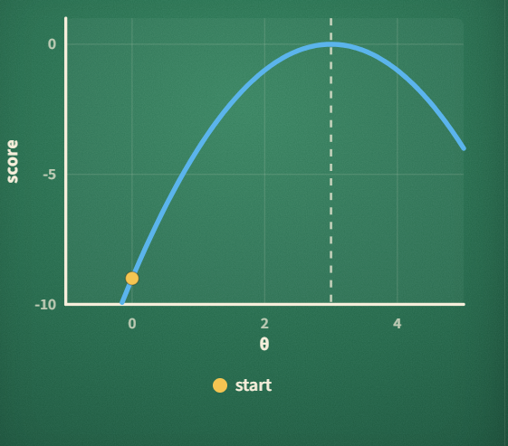

## Two steps up

Gradient ascent climbs score $(θ) = −(θ − 3)²$, whose slope is $∂score/∂θ=−2(θ−3)$. Each step does new $θ = θ + step size × 
∂score/∂θ$. It starts at θ = 0 with step size 0.25.

Where is θ after two steps? Give your answer to three decimal places.

#### **Answer:** 2.25

---

**Explanation**

**The idea**
Near the top the slope shrinks, so the steps shrink too.

**Solution**
Step one: $0+0.25×6=1.5$. \
Step two: $∂score/∂θ$ at $1.5$ is $3$, so 
$1.5+0.25×3=2.25$. Each step halves the distance to the top at $3$.

