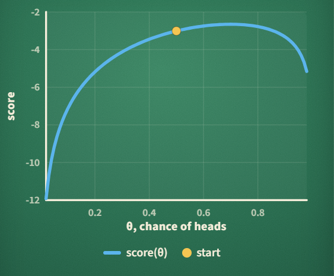

## Which way is uphill?

After 7 heads and 3 tails, the score of θ, the chance of heads, is score(θ) = 7 log₁₀ θ + 3 log₁₀(1 − θ). At θ = 0.5 the score is **−3.010**, and a nudge to θ = 0.51 gives **−2.976**.

Estimate $∂score/∂θ$ from these two looks. The nudge is only a look, so the step starts from $θ = 0.5$. Take one step with step size $0.02$. Where is θ now? Give your answer to three decimal places.

#### **Answer:** 0.568

---

**Explanation**

**The idea**
Two looks give the slope, and one step follows it uphill.

**Solution**

$∂score/∂θ ≈(−2.976−(−3.010)) ÷0.01 =3.4$. It is positive, so the step goes uphill:

$$
new θ =0.5+0.02×3.4=0.568
$$,

toward the top at θ = 0.7, the fraction of heads.