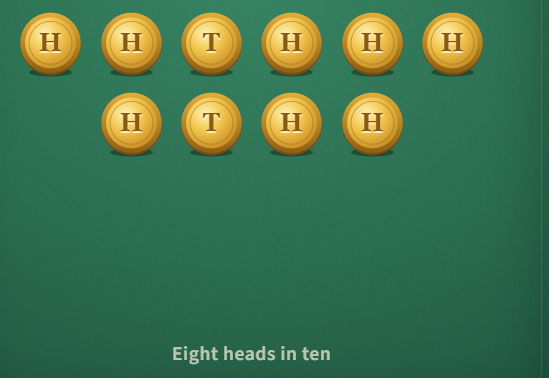

## How much more likely?

In 10 flips you see 8 heads. How many times more likely is this data if 
$p=0.8$ than if the coin is fair? Give your answer to three decimal places.

#### **Answer:** 6.872

---

**Explanation**

**The idea**
A likelihood ratio says how strongly data favors one explanation.

**Solution**
The ratio is

$$
\frac{0.8^8 \times 0.2^2}{0.5^{10}}
= \frac{0.0067109}{0.00097656}
\approx 6.872
$$

Using the chance of 8 heads in any order instead changes nothing: both likelihoods gain the same factor $\binom{10}{8}=45$, which cancels in the likelihood ratio.

In scores: $\log_{10}(6.87) \approx 0.84$, so the score at $p = 0.8$ is $0.84$ higher than at $p = 0.5$.

