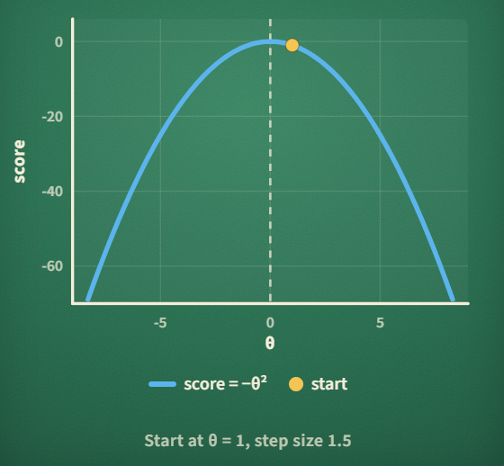

## Overshoot

Gradient ascent climbs $score(θ) = −θ²$, whose top is at θ = 0. Its slope is 
$∂score/∂θ=−2θ$, and each step does $new θ = θ + step size × ∂score/∂θ$.

Starting at $θ = 1$ with step size $1.5$, where is θ after three steps?

#### **Answer:** -8

---

**Explanation**

**The idea**
If the step size is too big, gradient ascent can jump past the peak and never settle.

**Solution**
Each step does $θ ← θ − 3θ = −2θ$:

$$
1→−2→4→−8
$$.

Every step jumps past the top and lands twice as far away. With step size 0.25 instead, each step halves θ and walks smoothly to the top.