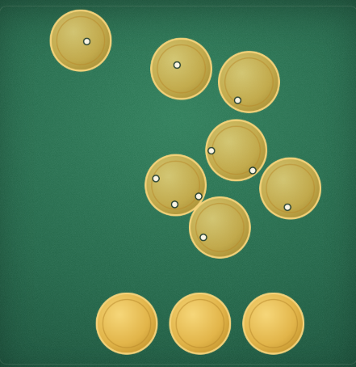

## A Tricky Tile

Ten tiny dots are drawn anywhere on a large table, and you have ten identical $1 coins. Coins may hang over the table’s edge.

Can you always place the coins flat on the table, with no two overlapping, so that every dot is covered?

A. Yes \
B. No

#### **Answer:** Option A: Yes

---

**Explanation**

**The idea**
A random choice can prove that a good choice exists.

**Solution**
We will use the probabilistic method. Fix an arrangement of dots. Consider the random process of dropping a honeycomb tiling of coins on the plane. 

Let $X_i$ be an indicator or Bernoulli random variable that is 1 when the $i-$ th dot is covered and 0 otherwise. 
We define $X = X_1 + X_2 + \cdots + X_{10}
$ to be the number of dots covered. Note that the tiling we chose covers $\frac{\pi}{2\sqrt{3}} \approx 0.9069$ of the plane. It follows that the $\mathbb{E}[X_i] \approx 0.9069$ as well. Thus we can use the linearity of expectation to compute markdown $
\mathbb{E}[X] = \mathbb{E}[X_1] + \mathbb{E}[X_2] + \cdots + \mathbb{E}[X_{10}] = 9.069
$.

If there was no way to tile the plane such that the ten coins were covered, then $\mathbb{E}[X] \leq 9$ Thus, there exists a way to tile the plane with coins such that the ten dots are covered. We can drop all the coins that do not cover a dot and conclude we can always cover the 10 dots with our 10 coins.
 